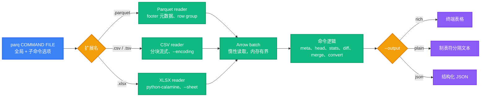

<div align="center">

# parq-cli

**在终端里查看、转换、对比表格文件。**

一个覆盖 `.parquet`、`.csv`、`.tsv`、`.xlsx` 的命令行工具，启动快，大文件不整表读进内存。

[](https://pypi.org/project/parq-cli/)
[](https://www.python.org/downloads/)
[](https://arrow.apache.org/docs/python/)
[](https://typer.tiangolo.com/)
[](https://github.com/Textualize/rich)
[](LICENSE)

[快速开始](#快速开始) · [命令参考](#命令参考) · [输出模式](#输出模式) · [大文件](#大文件说明)

<sub>中文 · [English](README_en.md)</sub>


</div>

---

## 简介

`parq` 面向日常最常见的表格文件操作：

- 查看元数据和 schema
- 预览前几行或后几行
- 统计总行数
- 按文件数或记录数拆分文件
- 生成轻量列统计（字符串列带基数和出现最多的值）
- 在多种格式之间转换
- 按主键对比两份数据
- 合并兼容文件

CLI 用惰性导入保持启动轻快；`plain` 和 `json` 两种输出模式留给脚本；对大 CSV/XLSX 的若干场景避免无意义的整表物化。

## 安装

```bash
pip install parq-cli
```

要读 `.xlsx` 需要可选依赖（读取用 `python-calamine`，写出用 `openpyxl`）：

```bash
pip install "parq-cli[xlsx]"
```

## 快速开始

一个文件就能看出 `parq` 在做什么。把 `data.parquet` 放在当前目录下：

```bash
parq meta data.parquet
parq head -n 3 data.parquet
parq count data.parquet
```

`parq meta` 打印路径、格式、列数、文件大小和 row group 数量；`parq head -n 3` 以表格打印前三行；`parq count` 打印总行数。脚本里要用的话，任何一条命令加上 `--output json` 都能拿到结构化结果。

最常用的命令：

```bash
# 查看元数据
parq meta data.parquet
parq meta --fast data.csv

# 查看 schema
parq schema data.xlsx

# 预览数据
parq head data.parquet
parq head -n 10 --columns id,name data.csv
parq tail -n 20 data.csv

# 统计总行数
parq count data.parquet

# 拆分文件
parq split data.csv --record-count 100000 -n "chunks/part-%03d.csv"
parq split data.parquet --file-count 4 -n "chunks/part-%02d.parquet"
parq split data.csv --record-count 100000 -n "out/part-%03d.csv" --force

# 列统计（字符串列包含基数和出现最多的值）
parq stats sales.parquet --columns amount,category --limit 10
parq stats sales.parquet --columns category --top-n 10

# 格式转换（带实时进度条）
parq convert raw.xlsx cleaned.parquet
parq convert source.parquet export.csv --columns id,name,status
parq convert source.parquet export.csv --force

# 读取 TSV 或自定义分隔符
parq head data.tsv
parq head --delimiter ";" data.csv

# 读取 XLSX 的指定工作表
parq head --sheet Sheet2 report.xlsx
parq head --sheet 1 report.xlsx

# 数据对比
parq diff old.parquet new.parquet --key id --columns status,amount
parq diff left.csv right.csv --key id --summary-only

# 合并兼容输入（带实时进度条）
parq merge part-001.parquet part-002.parquet merged.parquet
parq merge chunks/*.parquet merged.parquet --force
```

## 命令如何执行

所有子命令走同一条路径：扩展名决定用哪个 reader，reader 产出 Arrow batch，最后由 formatter 按选定的输出模式渲染。



## 支持的格式

| 命令 | Parquet | CSV | TSV | XLSX |
| --- | --- | --- | --- | --- |
| `meta` | 支持 | 支持 | 支持 | 支持 |
| `schema` | 支持 | 支持 | 支持 | 支持 |
| `head` / `tail` | 支持 | 支持 | 支持 | 支持 |
| `count` | 支持 | 支持 | 支持 | 支持 |
| `split` | 支持 | 支持 | 支持 | 支持 |
| `stats` | 支持 | 支持 | 支持 | 支持 |
| `convert` | 支持 | 支持 | 支持 | 支持 |
| `diff` | 支持 | 支持 | 支持 | 支持 |
| `merge` | 支持 | 支持 | 支持 | 支持 |

公式单元格读取的是 Excel 已算出的缓存值，没有缓存的公式会是空值。`.tsv` 按扩展名自动使用制表符，其它分隔符用 `--delimiter`。CSV/TSV 默认按 UTF-8 读取，其它编码用 `--encoding`（例如 `gbk`）；某一列无法按该编码解码时读取会失败，表头对不上该编码时也一样。写出仍然是 UTF-8。

## 命令参考

### `meta`

```bash
parq meta FILE
parq meta --fast FILE
```

显示文件级元数据，例如路径、格式、列数、文件大小、row group 数量，以及在可用时显示行数和 Parquet 特有信息。`--fast` 适合大 CSV/XLSX 的快速探测，会跳过完整行数这类代价较高的字段。

### `schema`

```bash
parq schema FILE
```

显示列名、类型和 nullable 信息。

### `head` 与 `tail`

```bash
parq head FILE
parq head -n 20 FILE
parq head -n 20 --columns id,name FILE

parq tail FILE
parq tail -n 20 FILE
parq tail -n 20 --columns id,name FILE
```

- 默认预览 `5` 行
- `--columns` 支持逗号分隔列名
- 文件不存在时返回友好错误并以退出码 `1` 结束
- 只有表头的 CSV/XLSX 返回空预览，但仍保留识别到的列
- 没有表头且完全为空的 CSV 返回友好的 `Empty CSV file` 错误

### `count`

```bash
parq count FILE
```

返回总行数。

### `split`

```bash
parq split FILE --file-count N
parq split FILE --record-count N
parq split FILE --record-count 100000 -n "chunks/part-%03d.parquet"
parq split FILE --record-count 100000 -n "chunks/part-%03d.csv" --force
```

- `--file-count` 与 `--record-count` 二选一
- 输出格式由 `--name-format` 的后缀决定，包括 `.tsv`
- 默认遇到已存在的目标文件会报错；`--force` / `-F` 会覆盖
- 在 `--record-count` 模式下，CSV 单遍流式写出，进度条保持不确定状态
- XLSX 会在写出前解析一次；`--record-count` 模式下进度条同样保持不确定状态

### `stats`

```bash
parq stats FILE
parq stats FILE --columns amount,category
parq stats FILE --limit 20
parq stats FILE --columns category --top-n 10
```

计算按列汇总的轻量统计：

- 数值列输出 `count`、`null_count`、`min`、`max`、`mean`
- 字符串、布尔和时间列另外输出 `cardinality` 和 `top_values`（出现次数最多的 N 个值及其计数）
- 默认 `--top-n` 是 `5`；设为 `0` 则不输出 top values
- 默认 `--limit 50`，避免宽表直接刷满终端
- 不同值超过 1 万个时，基数和 top values 仍然是精确结果
- 空值只计入 `null_count`，不会被当成空字符串

### `convert`

```bash
parq convert SOURCE OUTPUT
parq convert SOURCE OUTPUT --columns id,name,status
parq convert SOURCE OUTPUT --force
```

输出格式由 `OUTPUT` 后缀决定。

- 当前目标格式为 `.parquet`、`.csv`、`.tsv`、`.xlsx`
- 能流式处理的路径会尽量流式处理
- 转换过程显示实时进度条；CSV 因为事先不知道行数，进度条保持不确定状态
- 默认遇到已存在的输出文件会报错；`--force` / `-F` 会覆盖

### `diff`

```bash
parq diff LEFT RIGHT --key id
parq diff LEFT RIGHT --key id1,id2 --columns status,amount
parq diff LEFT RIGHT --key id --summary-only
```

按主键比较两份数据，并输出行数差值、仅存在于左侧的数据、仅存在于右侧的数据、选定列上的变更行，以及仅某一侧存在的 schema 列和同名异型字段。

- `--key` 必填
- 输入可以是 Parquet、CSV、TSV 或 XLSX
- `--delimiter`、`--encoding` 和 `--sheet` 会同时用于左右两个输入
- XLSX 对比会完整解析选中的工作表，第 1000 行之后的值也能放宽列类型后再比较
- 类型不同一定会报告。`str(value)` 得到的文本不算单元格修改，其它文本算。主键仍按原值匹配，`1` 和 `"1"` 对不上
- 任一侧若出现重复 key，会直接报错
- 空主键会进入样本。列表或结构体列不能当主键
- 单侧超过 10 万行时，会把数据按主键散列到临时文件，而不是把全部 key 放进内存
- `--summary-only` 保留计数和类型差异，不输出变更行样本
- `--limit` 控制每类样本最多打印多少行，默认 `20`

### `merge`

```bash
parq merge INPUT1 INPUT2 OUTPUT
parq merge chunks/*.parquet merged.parquet
parq merge chunks/*.parquet merged.parquet --force
```

把多个兼容输入文件合并成一个输出文件，最后一个位置参数是输出路径。

- schema 必须一致，或能被 Arrow 安全统一
- 默认遇到已存在的输出文件会报错；`--force` / `-F` 会覆盖
- 输出格式由输出文件后缀决定，包括 `.tsv`
- 全局 `--delimiter`、`--encoding` 和 `--sheet` 会作用于每一个输入
- 合并过程显示实时进度条

## 输出模式

全局选项：

- `--version`, `-v`：显示版本号。放在子命令前面：`parq --version`
- `--output`, `-o`：选择输出格式（`rich` | `plain` | `json`）
- `--delimiter`, `-d`：CSV/TSV 输入分隔符，默认 `,`；`.tsv` 会自动使用制表符
- `--encoding`：CSV/TSV 输入编码，默认 `utf8`。写出仍然是 UTF-8
- `--sheet`：XLSX 工作表名称或从 0 开始的序号，默认活动工作表。纯数字会按序号处理，名叫 `1` 或 `2` 的工作表也一样
- `--help`：显示帮助

`--output`、`--delimiter`、`--sheet`、`--encoding` 可以写在子命令前面，也可以写在子命令上面；同一个选项两处都写时，子命令上的值生效。`convert` 的 `--output` / `-o` 仍然是显示格式，目标文件是位置参数 `OUTPUT`。

| 模式 | 适合 |
| --- | --- |
| `rich` | 人在终端里阅读 |
| `plain` | 低开销、便于 shell 管道处理 |
| `json` | 程序消费和集成 |

```bash
parq meta data.parquet --output json
parq --output plain stats data.csv
parq --delimiter ";" head semicolon_data.csv
parq --sheet "Sales" head report.xlsx
parq diff left.parquet right.parquet --key id --summary-only --output json
```

在 Windows 非 UTF-8 终端中，Rich 标题会自动降级为安全样式，不会因为 emoji 或特殊字符编码失败而崩溃。

## 大文件说明

- Parquet 的元数据和行数来自文件 footer。`head` 拿到请求的行数就停，包括这些行落在同一个大 row group 里的情况。`tail` 只读包含末尾行的 row group。
- CSV `tail` 扫一遍文件，保留末尾的 Arrow batch，再切出最后几行。
- CSV 的 `split --record-count` 和 `convert` 单遍流式处理，进度条保持不确定状态，因为行数要等这一遍结束才知道。
- 对大 CSV/XLSX，`meta --fast` 是最快的元数据探查入口。
- `parq schema` 和较短的 `head` 对 XLSX 只采样前 1000 行。`count`、`tail`、`stats`、`convert`、`split`、`merge`、`diff` 把选中的工作表解析一次，后续值放不进样本类型时放宽该列，并把这些行留在内存里复用。
- `split --record-count` 在写出过程中进度条保持不确定状态。
- `diff` 每侧最多在内存里索引 10 万行，超过的部分按主键散列到临时 Parquet 文件。

如果你会反复处理大文件，把 CSV/XLSX 先转成 Parquet 依然是吞吐量最好的路径。

## 开发

```bash
uv sync --extra dev
```

或者：

```bash
pip install -e ".[dev]"
```

常用命令：

```bash
python -m parq --help
pytest -m "not performance"
pytest tests/test_performance.py -m performance -q -s
ruff check parq tests
ruff check --fix parq tests
pytest --cov=parq --cov-report=html
```

## 文档

- [docs/QUICKSTART.md](docs/QUICKSTART.md)：带引导的上手流程，包含测试数据生成
- [examples/README.md](examples/README.md)：示例文件与完整示例
- [docs/RELEASE.md](docs/RELEASE.md)：发布流程

## 当前状态

已经完成：元数据与 schema 查看、head / tail 预览、行数统计、文件拆分（带进度条与 `--force`）、列统计（数值列 + 字符串基数/top values）、格式转换（带进度条）、基于主键的数据对比、兼容文件合并、TSV 自动识别与自定义分隔符、XLSX 多工作表选择。

后续更适合继续打磨的方向，是更深入的性能优化、更丰富的 diff 工作流，以及更完整的报告能力，而不是再从零补齐这些基础命令。

## License

[MIT](LICENSE)
