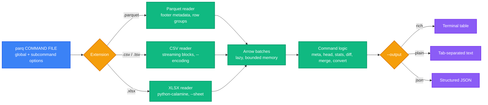

<div align="center">

# parq-cli

**Inspect, convert and compare tabular files from the terminal.**

One command-line tool for `.parquet`, `.csv`, `.tsv` and `.xlsx` that starts fast and never loads a whole large table just to look at it.

[](https://pypi.org/project/parq-cli/)
[](https://www.python.org/downloads/)
[](https://arrow.apache.org/docs/python/)
[](https://typer.tiangolo.com/)
[](https://github.com/Textualize/rich)
[](LICENSE)

[Quick Start](#quick-start) · [Command Reference](#command-reference) · [Output Modes](#output-modes) · [Large Files](#large-file-notes)

<sub>[中文](README.md) · English</sub>


</div>

---

## Overview

`parq` covers the table-file chores that come up most often:

- inspect metadata and schema
- preview the first or last rows
- count rows
- split large files by file count or record count
- compute lightweight column stats (with cardinality and top values for string columns)
- convert between supported formats
- diff two datasets by key
- merge compatible files

The CLI keeps startup light with lazy imports, keeps `plain` and `json` output modes for scripting, and avoids pointless full-table materialization for large CSV/XLSX workflows.

## Installation

```bash
pip install parq-cli
```

Reading `.xlsx` needs the optional extra (reads use `python-calamine`, writes use `openpyxl`):

```bash
pip install "parq-cli[xlsx]"
```

## Quick Start

One file is enough to see what `parq` does. With `data.parquet` in the current directory:

```bash
parq meta data.parquet
parq head -n 3 data.parquet
parq count data.parquet
```

`parq meta` prints the path, format, column count, file size and row-group count; `parq head -n 3` prints the first three rows as a table; `parq count` prints the total row count. Add `--output json` to any of them when a script needs to parse the result.

The commands that come up most often:

```bash
# Inspect metadata
parq meta data.parquet
parq meta --fast data.csv

# Show schema
parq schema data.xlsx

# Preview rows
parq head data.parquet
parq head -n 10 --columns id,name data.csv
parq tail -n 20 data.csv

# Count rows
parq count data.parquet

# Split files
parq split data.csv --record-count 100000 -n "chunks/part-%03d.csv"
parq split data.parquet --file-count 4 -n "chunks/part-%02d.parquet"
parq split data.csv --record-count 100000 -n "out/part-%03d.csv" --force

# Column statistics (string columns include cardinality and top values)
parq stats sales.parquet --columns amount,category --limit 10
parq stats sales.parquet --columns category --top-n 10

# Format conversion (with a live progress bar)
parq convert raw.xlsx cleaned.parquet
parq convert source.parquet export.csv --columns id,name,status
parq convert source.parquet export.csv --force

# Read TSV files or use a custom delimiter
parq head data.tsv
parq head --delimiter ";" data.csv

# Read a specific XLSX sheet
parq head --sheet Sheet2 report.xlsx
parq head --sheet 1 report.xlsx

# Dataset diff
parq diff old.parquet new.parquet --key id --columns status,amount
parq diff left.csv right.csv --key id --summary-only

# Merge compatible inputs (with a live progress bar)
parq merge part-001.parquet part-002.parquet merged.parquet
parq merge chunks/*.parquet merged.parquet --force
```

## How a command runs

Every subcommand takes the same path: the extension picks a reader, the reader yields Arrow batches, and the formatter renders them in the selected output mode.



## Supported formats

| Command | Parquet | CSV | TSV | XLSX |
| --- | --- | --- | --- | --- |
| `meta` | yes | yes | yes | yes |
| `schema` | yes | yes | yes | yes |
| `head` / `tail` | yes | yes | yes | yes |
| `count` | yes | yes | yes | yes |
| `split` | yes | yes | yes | yes |
| `stats` | yes | yes | yes | yes |
| `convert` | yes | yes | yes | yes |
| `diff` | yes | yes | yes | yes |
| `merge` | yes | yes | yes | yes |

Formula cells are read from Excel's cached value, so a formula Excel has not calculated comes back empty. `.tsv` is detected by extension and uses tabs automatically; other delimiters come from `--delimiter`. CSV and TSV reads default to UTF-8; pass `--encoding gbk` (or another codec) for anything else, and a column that does not decode with it fails the read, including a header. Writes stay UTF-8.

## Command Reference

### `meta`

```bash
parq meta FILE
parq meta --fast FILE
```

Shows file-level metadata: path, format, column count, file size, row-group count, and where available the row count and Parquet-specific metadata. `--fast` is the quick probe for large CSV/XLSX files; it skips expensive fields such as the full row count.

### `schema`

```bash
parq schema FILE
```

Shows column names, types and nullability.

### `head` and `tail`

```bash
parq head FILE
parq head -n 20 FILE
parq head -n 20 --columns id,name FILE

parq tail FILE
parq tail -n 20 FILE
parq tail -n 20 --columns id,name FILE
```

- the default preview is `5` rows
- `--columns` takes a comma-separated list
- a missing file returns a friendly error with exit code `1`
- a header-only CSV/XLSX returns an empty preview that still lists the columns
- a completely empty CSV with no header returns the friendly `Empty CSV file` error

### `count`

```bash
parq count FILE
```

Returns the total row count.

### `split`

```bash
parq split FILE --file-count N
parq split FILE --record-count N
parq split FILE --record-count 100000 -n "chunks/part-%03d.parquet"
parq split FILE --record-count 100000 -n "chunks/part-%03d.csv" --force
```

- pass exactly one of `--file-count` or `--record-count`
- the output format follows the `--name-format` suffix, including `.tsv`
- existing target files raise an error; `--force` / `-F` overwrites them
- in `--record-count` mode CSV streams in one pass and the progress bar stays indeterminate
- XLSX is parsed once before writing; in `--record-count` mode its progress bar is indeterminate too

### `stats`

```bash
parq stats FILE
parq stats FILE --columns amount,category
parq stats FILE --limit 20
parq stats FILE --columns category --top-n 10
```

Computes lightweight per-column statistics:

- numeric columns report `count`, `null_count`, `min`, `max`, `mean`
- string, boolean and date columns also report `cardinality` and `top_values` (the N most frequent values with their counts)
- `--top-n` defaults to `5`; set it to `0` to suppress top values
- `--limit` defaults to `50`, so a wide table does not flood the terminal
- cardinality and top values stay exact beyond 10,000 distinct values
- nulls stay in `null_count` and are never treated as empty strings

### `convert`

```bash
parq convert SOURCE OUTPUT
parq convert SOURCE OUTPUT --columns id,name,status
parq convert SOURCE OUTPUT --force
```

The output format follows the `OUTPUT` suffix.

- current targets are `.parquet`, `.csv`, `.tsv` and `.xlsx`
- paths that can stream do stream
- a live progress bar runs during the conversion; CSV stays indeterminate because the row count is unknown up front
- existing output files raise an error; `--force` / `-F` overwrites them

### `diff`

```bash
parq diff LEFT RIGHT --key id
parq diff LEFT RIGHT --key id1,id2 --columns status,amount
parq diff LEFT RIGHT --key id --summary-only
```

Compares two datasets by key and reports the row-count delta, rows only on the left, rows only on the right, changed rows for the selected columns, and schema-only columns plus same-name type mismatches.

- `--key` is required
- inputs can be Parquet, CSV, TSV or XLSX
- `--delimiter`, `--encoding` and `--sheet` apply to both inputs
- an XLSX diff parses the whole selected sheet, so a later value can widen a column before types are compared
- a type difference is always reported; text from `str(value)` is not a cell edit, any other text is; keys stay exact, so `1` and `"1"` do not match
- duplicate keys on either side are an error
- null keys appear in the sample; a list or struct column cannot be a key
- past 100,000 rows on a side the rows are hashed into temporary files instead of holding every key in memory
- `--summary-only` keeps the counts and type mismatches and omits sample rows
- `--limit` caps how many sample rows are printed per category, default `20`

### `merge`

```bash
parq merge INPUT1 INPUT2 OUTPUT
parq merge chunks/*.parquet merged.parquet
parq merge chunks/*.parquet merged.parquet --force
```

Merges several compatible inputs into one output file; the last positional argument is the output path.

- schemas must be identical or safely unifiable by Arrow
- existing output files raise an error; `--force` / `-F` overwrites them
- the output format follows the output suffix, including `.tsv`
- the global `--delimiter`, `--encoding` and `--sheet` apply to every input
- a live progress bar runs during the merge

## Output Modes

Global options:

- `--version`, `-v`: print the version. Put it before the subcommand: `parq --version`
- `--output`, `-o`: pick the output format (`rich` | `plain` | `json`)
- `--delimiter`, `-d`: CSV/TSV input delimiter, default `,`; `.tsv` uses tabs automatically
- `--encoding`: CSV/TSV input encoding, default `utf8`; writes stay UTF-8
- `--sheet`: XLSX sheet name or 0-based index, default the active sheet; an all-digit value is an index, even for a sheet actually named `1` or `2`
- `--help`: show help

`--output`, `--delimiter`, `--sheet` and `--encoding` work before the subcommand and on it; when both are set, the subcommand wins. On `convert`, `--output` / `-o` still selects the display format, and the destination is the `OUTPUT` positional.

| Mode | Best for |
| --- | --- |
| `rich` | reading in a terminal |
| `plain` | low overhead, easy for shell pipelines |
| `json` | scripts and integrations |

```bash
parq meta data.parquet --output json
parq --output plain stats data.csv
parq --delimiter ";" head semicolon_data.csv
parq --sheet "Sales" head report.xlsx
parq diff left.parquet right.parquet --key id --summary-only --output json
```

On Windows terminals that are not UTF-8, Rich headings fall back to a safe style instead of crashing on emoji or unusual characters.

## Large File Notes

- Parquet metadata and row counts come from the file footer. `head` stops once it has the requested rows, including when they sit inside one large row group; `tail` reads only the row groups holding the last rows.
- CSV `tail` scans the file once, keeps the trailing Arrow batches and slices the last rows.
- CSV `split --record-count` and `convert` stream in one pass, so their progress bars stay indeterminate until the pass ends.
- For large CSV/XLSX, `meta --fast` is the quickest way to probe metadata.
- `parq schema` and a short `head` sample only the first 1000 XLSX rows. `count`, `tail`, `stats`, `convert`, `split`, `merge` and `diff` parse the selected sheet once, widen a column when a later value does not fit the sample, and keep those rows in memory.
- `split --record-count` keeps its progress bar indeterminate while writing.
- `diff` indexes at most 100,000 rows per side in memory and hash-partitions the rest into temporary Parquet files.

For repeated heavy workflows, converting large CSV/XLSX files to Parquet is still the best path for throughput.

## Development

```bash
uv sync --extra dev
```

or:

```bash
pip install -e ".[dev]"
```

Common commands:

```bash
python -m parq --help
pytest -m "not performance"
pytest tests/test_performance.py -m performance -q -s
ruff check parq tests
ruff check --fix parq tests
pytest --cov=parq --cov-report=html
```

## Documentation

- [docs/QUICKSTART.md](docs/QUICKSTART.md): a guided first session, including test-data generation
- [examples/README.md](examples/README.md): sample files and worked examples
- [docs/RELEASE.md](docs/RELEASE.md): how a release is cut

## Status

Implemented: metadata and schema inspection, head / tail preview, row counting, file splitting (with progress bar and `--force`), column statistics (numeric plus string cardinality/top values), format conversion (with progress bar), keyed dataset diff, compatible file merge, TSV auto-detection with custom delimiters, and XLSX sheet selection.

The work left is deeper performance tuning, richer diff workflows and fuller reporting, not building the core commands from scratch.

## License

[MIT](LICENSE)
